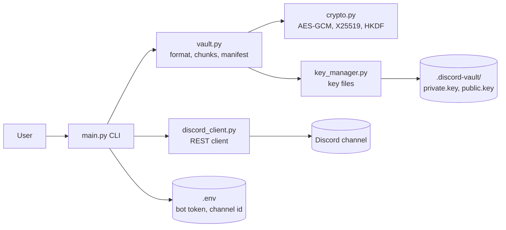

# 00. Project Overview

Start here. This series teaches the DiscordVault codebase and the applied cryptography inside it.
Every claim is tied to source at commit `3acb26a` (`main`). Line numbers refer to that state.

## Reading order

| # | File | Question it answers |
| --- | --- | --- |
| 00 | this file | What is this project? |
| 01 | [architecture](01-architecture.md) | How is the code organised? |
| 02 | [cryptography fundamentals](02-cryptography-fundamentals.md) | What does each primitive do? |
| 03 | [key hierarchy](03-key-hierarchy.md) | Which keys exist and how do they relate? |
| 04 | [encryption/decryption flow](04-encryption-decryption-flow.md) | What happens to bytes, step by step? |
| 05 | [application workflow](05-application-workflow.md) | What happens when I run each command? |
| 06 | [function reference](06-function-reference.md) | What does each function do? |
| 07 | [security audit](07-security-audit.md) | What is weak? |
| 08 | [learning roadmap](08-learning-roadmap.md) | How do I learn this properly? |

An older single-file summary exists at `docs/PROJECT_DEEP_DIVE.md`. The `learning/` series supersedes it where they differ.

## What DiscordVault does

DiscordVault is a Python command-line tool that stores files on Discord as encrypted data.

1. You run `upload <file-or-folder>`.
2. The file (or a ZIP of the folder) is encrypted on your machine with AES-256-GCM, in ~6 MB chunks.
3. Each encrypted chunk is written into a 1920x1080 RGB PNG image.
4. A Discord bot posts a `manifest.json` message and then one message per PNG into a text channel.
5. You run `restore <vault_id>`. The tool downloads the messages, decrypts, verifies hashes, and rebuilds the original.

Discord receives ciphertext plus a plaintext manifest. The key that can decrypt it stays in `.discord-vault/private.key`.

## Core features (verified in source)

- AES-256-GCM encryption per chunk (`src/crypto.py:20`, `src/vault.py:215`).
- Envelope encryption: a random per-vault key wrapped with ephemeral X25519 + HKDF-SHA256 + AES-256-GCM (`src/crypto.py:83`).
- Fixed 128-byte binary chunk header, authenticated as AES-GCM associated data (`src/vault.py:87`, `:251`).
- SHA-256 integrity checks per chunk and for the whole file (`src/vault.py:329`, `:873`).
- Folder support through a temporary ZIP, with a path-traversal check on extraction (`src/vault.py:362`, `:626`).
- Discord REST client with pagination and HTTP 429 retry (`src/discord_client.py:87`, `:290`).
- CLI commands: `upload`, `list`, `restore`, `encode`, `decode` (`src/main.py:247`).

## What does NOT exist

The prompt that produced this series listed many concepts. These are confirmed absent in the source:

- No user accounts, passwords, login or sessions. There is no authentication layer in the application. The only credentials are the Discord bot token and your key files.
- No database. The only "storage" is the Discord channel (message text acts as an index) plus local key files.
- No password-based key derivation (no Argon2, PBKDF2 or scrypt). HKDF is used only to turn a Diffie-Hellman result into a key.
- No RSA, ChaCha20-Poly1305, HMAC (as a separate primitive), or digital signatures.
- No key rotation, key backup, multi-recipient support, or vault deletion.

## Technology stack

| Piece | Choice | Where |
| --- | --- | --- |
| Language | Python 3 (uses `X \| None` syntax, so 3.10+; docs say 3.13) | all of `src/` |
| Crypto | `cryptography` (pinned `50.0.0` in `requirements.txt`) | `src/crypto.py`, `src/key_manager.py` |
| Images | `Pillow` | `src/vault.py:13` |
| HTTP | `requests` | `src/discord_client.py:8` |
| Config | `python-dotenv` | `src/discord_client.py:11` |
| Tests | `pytest` | `tests/` |

Randomness comes from Python's `secrets` module (OS CSPRNG) and from `X25519PrivateKey.generate()`.

## High-level architecture

Details are in [01-architecture.md](01-architecture.md).
