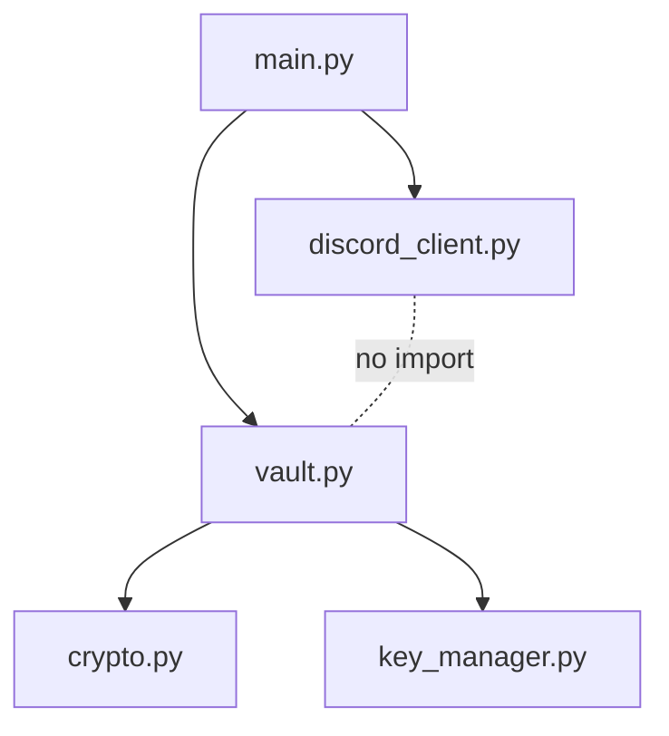
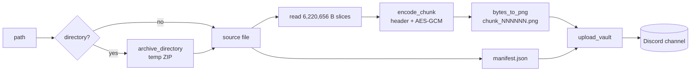
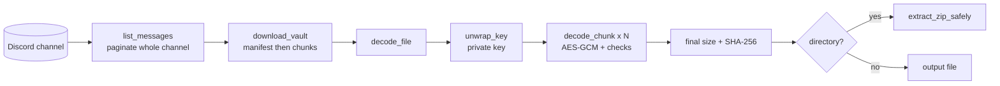

# 01. Architecture

See [00-project-overview.md](00-project-overview.md) for the goals. This file covers structure and data flow.

## Repository layout

```text
src/
  crypto.py          156 lines   primitives, no I/O
  key_manager.py      71 lines   keypair file I/O
  vault.py           918 lines   chunk format, PNG codec, manifest, encode/decode, ZIP
  discord_client.py  705 lines   Discord REST client
  main.py            372 lines   argparse CLI and orchestration
tests/
  test_crypto.py     5 tests
  test_vault.py     10 tests
```

## Dependency direction



- `discord_client.py` imports nothing from `vault.py`, `crypto.py` or `key_manager.py`. It moves opaque files and reads message text. This is verified by its import list (`src/discord_client.py:1-11`).
- `crypto.py` performs no file or network I/O, so it can be unit-tested alone.
- `vault.py` is the only module that knows the byte layout of chunks and the manifest. It is the bridge between crypto and files.
- `main.py` owns temporary directories and user-facing error text.

Why it matters: swapping Discord for another backend means replacing one module. Auditing crypto means reading one module.

## Component responsibilities

| Module | Owns | Does not own |
| --- | --- | --- |
| `crypto.py` | AES-GCM encrypt/decrypt, file-key generation, key wrap/unwrap, HKDF | files, keys on disk |
| `key_manager.py` | creating and loading the X25519 keypair at `.discord-vault/` | any encryption |
| `vault.py` | header format, PNG codec, chunk encode/decode, manifest, ZIP, verification | network |
| `discord_client.py` | auth header, rate limits, upload, pagination, download, vault listing | crypto, keys |
| `main.py` | commands, temp dirs, output paths | formats, crypto |

## Data flow: upload



## Data flow: restore



## Where state lives

| State | Location | Notes |
| --- | --- | --- |
| Private/public key | `.discord-vault/` in repo root | derived from `__file__` (`src/key_manager.py:9-14`) |
| Bot token, channel ID | `.env` / environment | `os.getenv` (`src/discord_client.py:62`, `src/main.py:30`) |
| Vault index | Discord message text, e.g. `DiscordVault vault=<id> type=chunk index=3` | no local DB |
| Vault metadata | `manifest.json` attachment, plaintext | see [03](03-key-hierarchy.md), [07](07-security-audit.md) |
| Temp encrypted data | `tempfile` directories | removed by `TemporaryDirectory` and `finally` |

## Design observations

- The Discord channel is the database. Listing and restoring cost O(messages in channel) because every call walks the full history (`list_messages`, `src/discord_client.py:290`).
- Chunks are independent AES-GCM messages. Order and completeness are enforced by authenticated header fields plus the manifest, not by a chained construction.
- Everything is sequential. There is no concurrency.

Next: [02-cryptography-fundamentals.md](02-cryptography-fundamentals.md).
