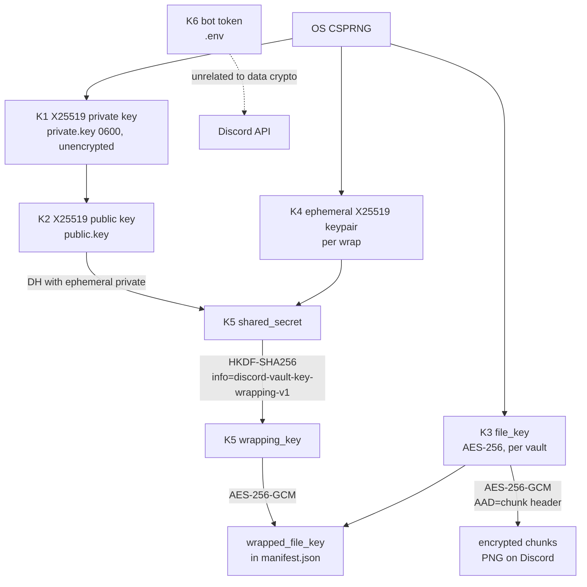
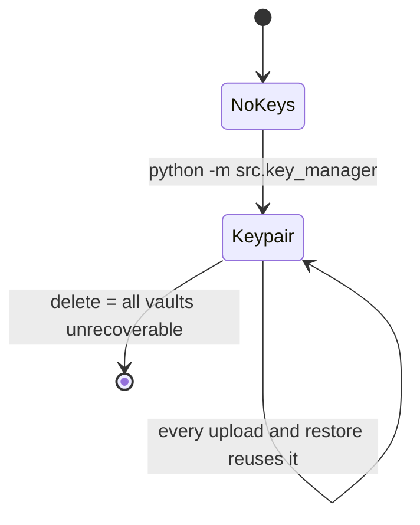

# 03. Key Hierarchy

Terms are defined in [02-cryptography-fundamentals.md](02-cryptography-fundamentals.md). All values below are illustrative. No real secrets are included.

## Categories that exist and do not exist

| Category | Exists? | Instance |
| --- | --- | --- |
| Master key | Effectively yes | the X25519 private key (`PRIVATE_KEY_PATH`) |
| DEK (data encryption key) | Yes | `file_key` |
| KEK (key encryption key) | Yes, but derived per wrap | `wrapping_key` (derived), protected by the private key |
| Password-derived key | No | |
| Session key | No | |
| API key / bot token | Yes | `DISCORD_BOT_TOKEN` |
| Authentication secret | Only the bot token | no user auth exists |
| Salts | None used (`salt=None` in HKDF) | |
| Nonces | Yes | chunk nonce, wrap nonce |

## Key inventory

### K1. X25519 private key

| Property | Value |
| --- | --- |
| Identifier | `private_key`, file `PRIVATE_KEY_PATH` (`src/key_manager.py:13`) |
| Purpose | Recovers `file_key` of every vault. Master secret of the system |
| Origin | `X25519PrivateKey.generate()` (`src/key_manager.py:29`) |
| Algorithm | X25519 |
| Length | 32 bytes, raw |
| Storage | `.discord-vault/private.key`, mode 0600, **unencrypted** (`src/key_manager.py:33-48`) |
| Lifetime | Until you delete it. Never rotated |
| Dependencies | None |
| Usage | `load_private_key` (`:55`), `unwrap_key` (`src/crypto.py:132`), `decode_file` (`src/vault.py:735`) |
| Exposure | Anyone able to read the file, and the restore process in memory |

### K2. X25519 public key

| Property | Value |
| --- | --- |
| Identifier | `public_key`, file `PUBLIC_KEY_PATH` |
| Purpose | Lets uploads lock `file_key` |
| Origin | Derived from K1 (`private_key.public_key()`, `src/key_manager.py:31`) |
| Length | 32 bytes |
| Storage | `.discord-vault/public.key`, mode 0644 |
| Usage | `load_public_key` (`:61`), `wrap_key` (`src/vault.py:477-482`) |
| Exposure | Not secret |

### K3. File key (DEK)

| Property | Value |
| --- | --- |
| Identifier | `file_key` (`src/vault.py:474`) |
| Purpose | Encrypts every chunk of one vault |
| Origin | `secrets.token_bytes(32)` via `generate_key` (`src/crypto.py:16`) |
| Algorithm | AES-256-GCM |
| Length | 32 bytes |
| Storage | Never stored in plaintext. Stored only wrapped inside `manifest.json` (`wrapped_file_key`) |
| Lifetime | In memory during one `encode_file` or `decode_file` call. One per vault |
| Dependencies | At rest, depends on K1 through the wrap |
| Usage | `encode_chunk` (`src/vault.py:251`), `decode_chunk` (`:317`) |
| Exposure | The Python process memory only |

### K4. Ephemeral X25519 keypair

| Property | Value |
| --- | --- |
| Identifier | `ephemeral_private`, `ephemeral_public` (`src/crypto.py:95-96`) |
| Purpose | One-time DH partner for the wrap |
| Origin | `X25519PrivateKey.generate()` per `wrap_key` call |
| Storage | Public half in manifest as `ephemeral_public_key` (base64). Private half is never stored or returned |
| Lifetime | Private half: one function call. Public half: as long as the manifest exists |
| Exposure | Public half is visible on Discord |

### K5. Shared secret and wrapping key (KEK)

| Property | Value |
| --- | --- |
| Identifier | `shared_secret`, `wrapping_key` (`src/crypto.py:101-113`) |
| Purpose | `wrapping_key` encrypts `file_key` |
| Origin | `shared_secret = ephemeral_private.exchange(recipient_public_key)`; `wrapping_key = HKDF(shared_secret)` |
| Length | 32 bytes each |
| Storage | None. Recomputed on restore from K1 and K4-public |
| Lifetime | One function call |

### K6. Discord bot token

| Property | Value |
| --- | --- |
| Identifier | `DISCORD_BOT_TOKEN`, `self.token` (`src/discord_client.py:62-65`) |
| Purpose | Authenticates the bot to Discord REST |
| Origin | Discord developer portal (user provided) |
| Storage | `.env` (gitignored) or process environment. Placeholder in `.env.example` |
| Lifetime | Until reset in the portal |
| Usage | `Authorization: Bot <token>` header on a `requests.Session` (`:74-81`) |
| Exposure | Process memory, `.env`. Not sent anywhere except Discord. Not logged in the code |

Not a secret but related: `DISCORD_CHANNEL_ID` (`src/main.py:30`).

### Nonces (not secret, must be unique)

| Identifier | Size | Where generated | Stored |
| --- | --- | --- | --- |
| chunk `nonce` | 12 B | `secrets.token_bytes(12)`, `src/vault.py:224` | Header bytes 48-59 |
| wrap `nonce` | 12 B | `src/crypto.py:111` | Manifest `wrapped_file_key.nonce` |

### Identifiers that look like keys but are not

- `file_id`: UUID4, 16 bytes (`src/vault.py:80`). A label, not a secret. It appears in cleartext in Discord message text and in the manifest.
- `sha256`: fingerprints (see [02](02-cryptography-fundamentals.md)).

## Key hierarchy diagram



The bot token is completely separate from the encryption hierarchy. Knowing it grants channel access, not decryption.

## Lifecycle



Per upload:

1. `file_key` generated.
2. `wrap_key` creates an ephemeral keypair, derives `wrapping_key`, encrypts `file_key`.
3. Chunks encrypted with `file_key`.
4. After `encode_file` returns, the Python variables go out of scope. The memory is not explicitly wiped.

Per restore:

1. `load_private_key` reads K1.
2. `unwrap_key` recomputes `shared_secret` and `wrapping_key`, then decrypts `file_key`.
3. `file_key` decrypts chunks.

## Manifest key material, annotated

```json
"wrapped_file_key": {
  "ephemeral_public_key": "base64(32 bytes)",
  "nonce": "base64(12 bytes)",
  "encrypted_file_key": "base64(48 bytes = 32 key + 16 tag)"
}
```

## Compromise scenarios

| What leaks | Result |
| --- | --- |
| `private.key` | Attacker with the channel data can decrypt **every** vault. Critical |
| `public.key` | Nothing. Allows creating valid vaults (see [07](07-security-audit.md), F2) |
| One `file_key` | That vault only. Other vaults use other keys |
| `DISCORD_BOT_TOKEN` | Attacker can read, post and (if permitted) delete in the channel. Can read the manifests (metadata) and ciphertext, cannot decrypt. Can upload forged vaults |
| `manifest.json` only | Filename, size, hashes. Not the file key |
| Channel contents only | Ciphertext and metadata, no decryption |
| Loss of `private.key` | All vaults permanently unreadable. There is no backup or recovery |
| Disk theft without full-disk encryption | Same as private key leak |

Next: [04-encryption-decryption-flow.md](04-encryption-decryption-flow.md).
