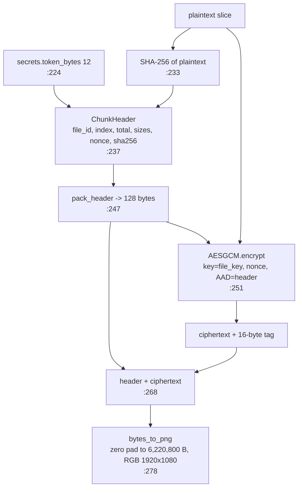
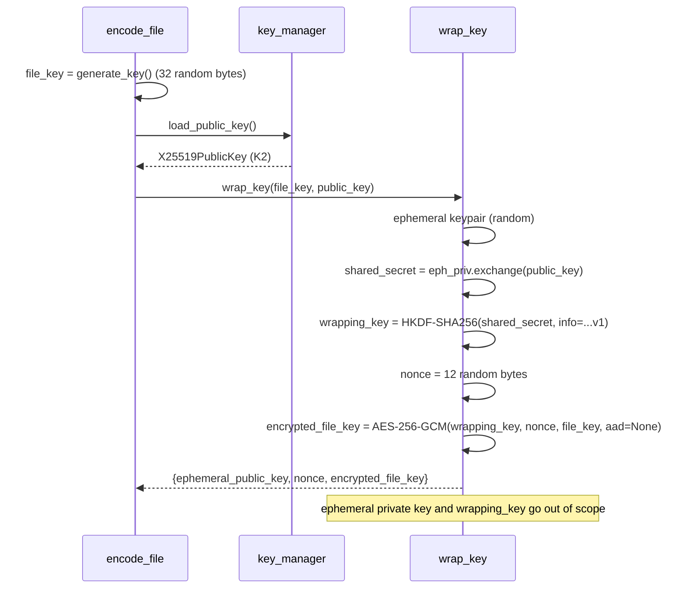
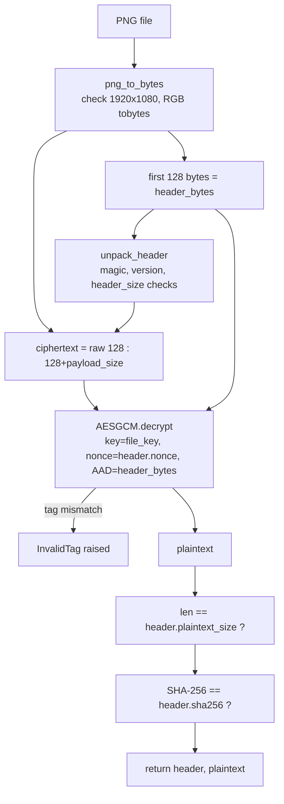
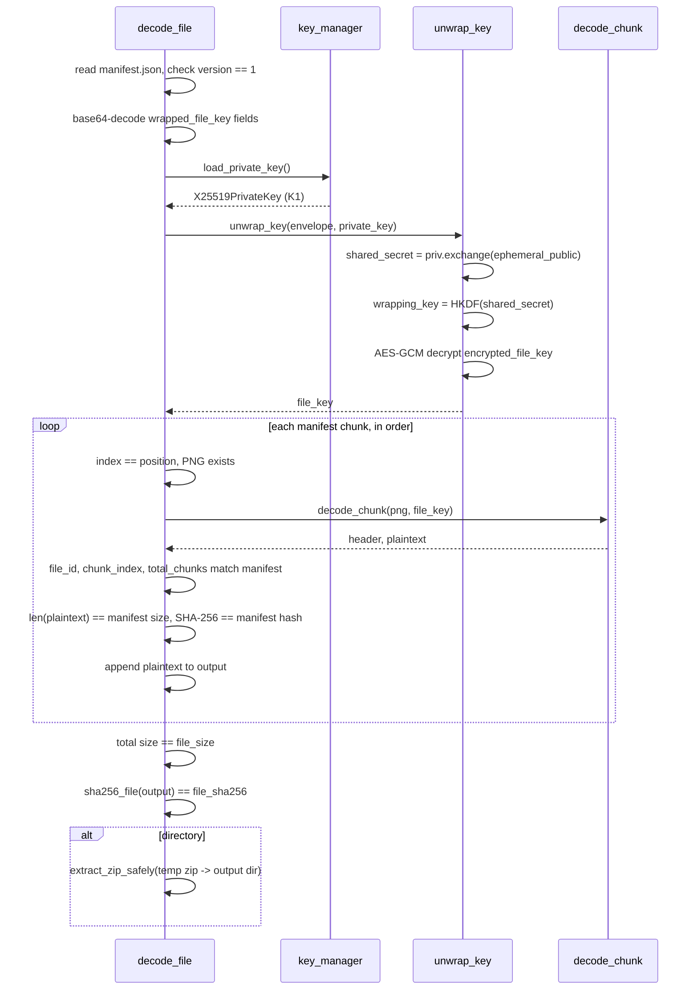

# 04. Encryption and Decryption Flow

Keys referenced here (K1 to K6) are defined in [03-key-hierarchy.md](03-key-hierarchy.md). Primitives are explained in [02](02-cryptography-fundamentals.md).

## Chunk size arithmetic (`src/vault.py:23-47`)

```text
IMAGE_CAPACITY = 1920 * 1080 * 3          = 6,220,800 bytes
CHUNK_SIZE     = 6,220,800 - 128 - 16     = 6,220,656 bytes  (plaintext per chunk)
```

For a full chunk the ciphertext is the plaintext plus the 16-byte tag, so 6,220,656 + 16 = 6,220,672 bytes. Adding the 128-byte header gives 6,220,800, which equals `IMAGE_CAPACITY`. A full chunk therefore fills the image exactly with no padding. Only the last chunk is padded with zero bytes.

## Chunk header (128 bytes)

`HEADER_FORMAT = "<4sBBH16sQQQ12sQ32s"` (`src/vault.py:49`). `<` means little-endian with no alignment padding.

| Offset | Size | Field | Notes |
| --- | --- | --- | --- |
| 0 | 4 | magic `DVLT` | rejects non-vault data |
| 4 | 1 | version `1` | |
| 5 | 1 | flags `0` | unused |
| 6 | 2 | header_size `128` | |
| 8 | 16 | file_id | UUID4 bytes |
| 24 | 8 | chunk_index | |
| 32 | 8 | total_chunks | |
| 40 | 8 | plaintext_size | |
| 48 | 12 | nonce | |
| 60 | 8 | payload_size | ciphertext length incl. tag |
| 68 | 32 | sha256 | of this chunk's plaintext |
| 100 | 28 | reserved zeros | |

The whole 128 bytes are the AES-GCM AAD, including the reserved bytes and unused `flags`. Verified: `header_bytes` (the packed bytes) is passed as `aad` at `src/vault.py:254`, and `raw[:HEADER_SIZE]` at `:293` and `:321`.

## Encryption of one chunk: `encode_chunk` (`src/vault.py:215-281`)



Sanity checks in this function: returned nonce equals the supplied nonce (`:258`), ciphertext length equals `len(plaintext)+16` (`:263`), total fits the image (`:272`).

## Wrapping the file key: `wrap_key` (`src/crypto.py:83-129`)



## Full upload encryption: `encode_file` (`src/vault.py:397-616`)

1. Validate input exists, create `output_dir` (`:405-411`).
2. If directory: `tempfile.mkdtemp` and `archive_directory` to a ZIP (`:421-461`). The ZIP then becomes `source_path`.
3. `file_size`, `total_chunks = ceil(file_size / CHUNK_SIZE)` (`:465-469`).
4. `file_id = uuid4().bytes`, `file_key = generate_key()` (`:471-474`).
5. `wrap_key(file_key, load_public_key())` (`:477-482`).
6. Loop: read `CHUNK_SIZE` bytes, `encode_chunk` to `chunk_%06d.png`, record `{index,size,sha256,image}` (`:486-530`).
7. Build and write `manifest.json` (`:532-598`). `file_sha256` comes from a second pass, `sha256_file(source_path)` (`:549`).
8. `finally`: delete the temporary ZIP directory (`:609-616`).

## Decryption of one chunk: `decode_chunk` (`src/vault.py:284-338`)



Order matters: the header is parsed before authentication, but only to learn lengths. Its content is authenticated by the tag when decrypting. A forged header causes `InvalidTag`, not silent acceptance. One caveat: `payload_size` is read from the unauthenticated header to slice the ciphertext, and Python slicing past the end just returns fewer bytes. The length check (`:312`) and the tag check catch a wrong value.

## Unwrapping and full restore: `decode_file` (`src/vault.py:664-919`)



Defensive layers in order of occurrence, with what each catches:

| Layer | Catches |
| --- | --- |
| `unwrap_key` GCM tag | wrong private key, tampered envelope |
| Magic / version / header_size | non-vault or future-format files |
| GCM tag over ciphertext + header | any bit flip in data or header, wrong file key |
| Header size and SHA-256 check | logic errors after decryption |
| `file_id`, `chunk_index`, `total_chunks` vs manifest | chunk from another vault, reordering, truncated manifest |
| Manifest size and SHA-256 per chunk | manifest/chunk disagreement |
| Total size and whole-file SHA-256 | any end-to-end error |
| `extract_zip_safely` | ZIP entries with `..` paths |

## Worked example (dummy values)

A 14,000,000-byte file:

- `total_chunks = ceil(14,000,000 / 6,220,656) = 3`.
- Chunks hold 6,220,656 + 6,220,656 + 1,558,688 bytes.
- Each chunk: 128 B header + (plaintext + 16 B tag) ciphertext, padded to 6,220,800 B, saved as an RGB PNG (`chunk_000000.png` .. `chunk_000002.png`).
- AES encryptions: 3 (data) + 1 (key wrap) = 4. See the count explanation in [02](02-cryptography-fundamentals.md) sections 2 and 5.

Next: [05-application-workflow.md](05-application-workflow.md).
