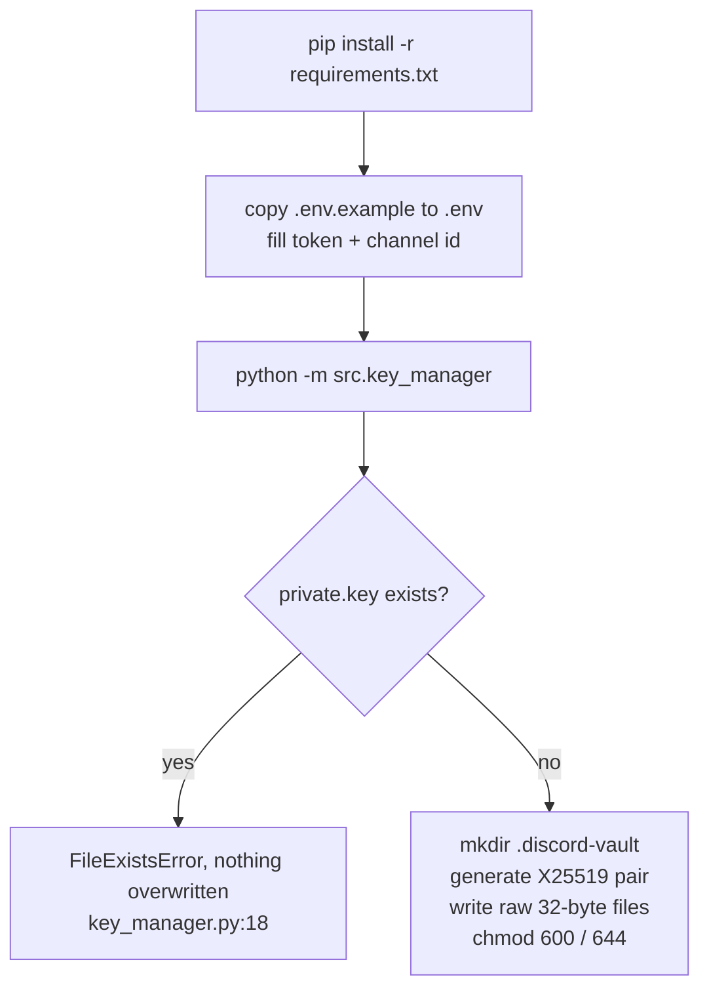
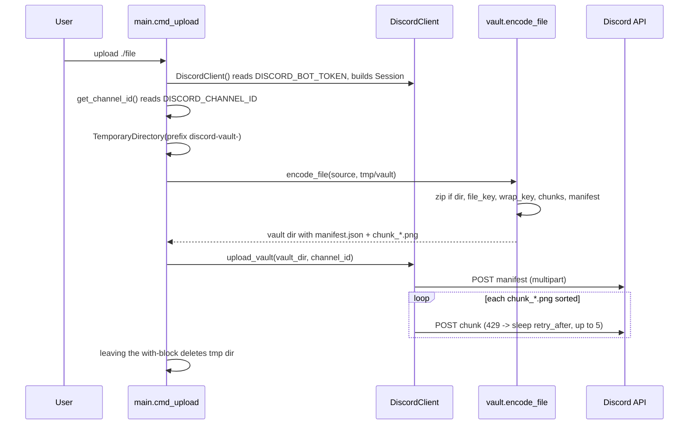
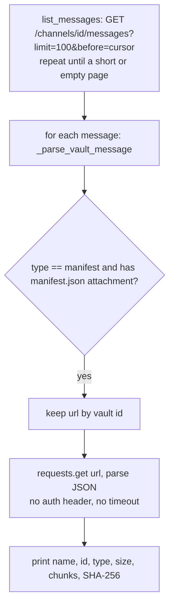
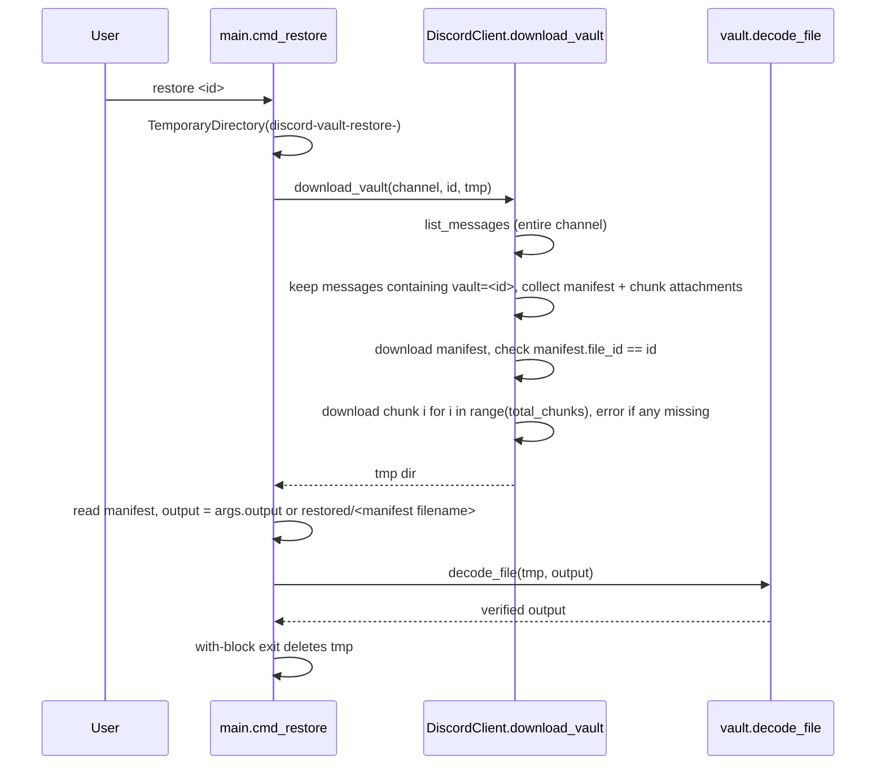

# 05. Application Workflow

Crypto internals are in [04](04-encryption-decryption-flow.md). This file traces each command from the CLI down.

## Lifecycle stages from your checklist, mapped to reality

| Stage | Reality in this codebase |
| --- | --- |
| Application startup | Run as a module (`python -m src.main ...`). `main()` parses args and dispatches (`src/main.py:247-369`). `discord_client.py` calls `load_dotenv()` on import (`:11`) |
| User authentication | **None.** No users, passwords or sessions. Possession of `private.key` is the only decryption "credential". The bot token authenticates the bot to Discord |
| Authorization | Delegated entirely to Discord channel permissions of the bot |
| Vault initialization | Implicit. A vault is created by `upload`. One-time setup is `python -m src.key_manager` |
| Database interactions | **None.** Discord messages are the index (see below) |
| Session termination | No sessions. Cleanup is `TemporaryDirectory` exit and `finally` blocks |

## Setup (once)

Nothing in `main.py` checks that the keypair exists. If it does not, `load_public_key()` raises `FileNotFoundError` mid-upload (after temp files are created and after the bot was constructed).

## Discord message index (the "database")

| Message text | Attachment | Written at |
| --- | --- | --- |
| `DiscordVault vault=<32hex> type=manifest` | `manifest.json` | `src/discord_client.py:378-386` |
| `DiscordVault vault=<32hex> type=chunk index=<n>` | `chunk_<n:06d>.png` | `:415-424` |

Lookups parse this text (`_parse_vault_message`, `:258-288`) or substring-match `vault=<id>` (`:478-482`).

## Workflow: `upload <path>`

Entry: `cmd_upload` (`src/main.py:54-88`).

Notes:
- The bot is constructed before checking that the source exists (`src/main.py:56-62`). Missing token fails first.
- Manifest is posted before chunks, so a failure mid-upload leaves a partial vault with no cleanup.
- Input: a path. Output: messages in the channel. Keys used: K2 (public) and K3 (file key) from [03](03-key-hierarchy.md); K6 (bot token) for HTTP.

## Workflow: `list`

Entry: `cmd_list` (`src/main.py:91-150`) -> `DiscordClient.list_vaults` (`src/discord_client.py:599-706`).

No private key is needed. Everything printed comes from the plaintext manifest.

## Workflow: `restore <id> [output]`

Entry: `cmd_restore` (`src/main.py:152-244`).

Error handling (verified):
- `DiscordError` from the download maps to `Error: vault '<id>' was not found.` and the function returns normally (exit code 0) (`src/main.py:175-182`).
- Any `Exception` from `decode_file` prints `Error: restore failed: ...` and returns (`:229-235`). Exit code stays 0.
- `restored/<manifest filename>` uses the manifest value unsanitised (`:204-211`). See [07](07-security-audit.md), F1.

## Workflow: `encode` and `decode` (local only)

`cmd_encode` / `cmd_decode` (`src/main.py:40-51`) call `encode_file` / `decode_file` directly. The vault directory is left on disk. Useful for testing without Discord.

## Cleanup behaviour

| Item | Mechanism | Verified at |
| --- | --- | --- |
| Temp ZIP during encode | `finally` + `shutil.rmtree` | `src/vault.py:609-616` |
| Temp vault dir on upload | `TemporaryDirectory` context | `src/main.py:64-88` |
| Temp download dir on restore | `TemporaryDirectory` context | `src/main.py:157-245` |
| Temp ZIP on restore | `finally` + `shutil.rmtree` | `src/vault.py:895-909` |
| Plaintext output on failed verification | **not removed** | `src/vault.py:788-790` writes straight to `output_file` for files |

## Failure modes worth remembering

- Upload interrupted: partial vault remains on Discord. No resume or delete.
- Missing keypair: `FileNotFoundError` during encode or decode.
- Wrong private key: `cryptography.exceptions.InvalidTag` from `unwrap_key`, reported as `restore failed` (its message is empty).
- Rate limit: waits `retry_after`, up to 5 tries, then `DiscordError`.

Next: [06-function-reference.md](06-function-reference.md).
