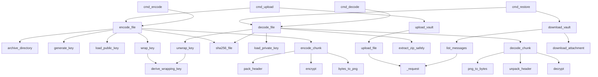

# 06. Function Reference

Line numbers are for commit `3acb26a`. Flow context is in [04](04-encryption-decryption-flow.md) and [05](05-application-workflow.md). Findings referenced as F# are in [07](07-security-audit.md).

## Call graph (core paths)



## `src/crypto.py`

| Function | Lines | Summary |
| --- | --- | --- |
| `generate_key() -> bytes` | 16-17 | `secrets.token_bytes(32)`. Used for `file_key`. Caller: `encode_file` (`vault.py:474`) |
| `encrypt(data, key, aad=None, nonce=None) -> (ct, nonce)` | 20-44 | Checks key is 32 B and nonce 12 B, creates `AESGCM(key)`, returns ciphertext incl. tag. Random nonce if none given. Caller: `encode_chunk` |
| `decrypt(ciphertext, key, nonce, aad=None) -> bytes` | 47-66 | Same length checks, `AESGCM.decrypt`. Raises `InvalidTag` on any mismatch. Caller: `decode_chunk` |
| `derive_wrapping_key(shared_secret) -> bytes` | 69-80 | HKDF-SHA256, 32 B, `salt=None`, `info=b"discord-vault-key-wrapping-v1"` |
| `wrap_key(file_key, recipient_public_key) -> dict` | 83-129 | Ephemeral X25519, exchange, HKDF, AES-GCM (no AAD). Returns three byte strings |
| `unwrap_key(envelope, recipient_private_key) -> bytes` | 132-156 | Reverse of `wrap_key`. No length checks on the envelope fields beyond what the library enforces |

Security notes:
- `encrypt` never checks nonce uniqueness. Uniqueness depends on callers using random nonces (they do).
- The wrap has no AAD. The ephemeral public key and nonce are not bound into the tag or HKDF context (F9).

Snippet (`src/crypto.py:73-78`):

```python
hkdf = HKDF(algorithm=hashes.SHA256(), length=KEY_SIZE,
            salt=None, info=b"discord-vault-key-wrapping-v1")
return hkdf.derive(shared_secret)
```

## `src/key_manager.py`

| Function | Lines | Summary |
| --- | --- | --- |
| `generate_keypair() -> None` | 17-52 | Refuses if `private.key` exists. Writes raw 32-byte key files, then `chmod` 0600 / 0644 (F3) |
| `load_private_key()` | 55-58 | `X25519PrivateKey.from_private_bytes(PRIVATE_KEY_PATH.read_bytes())`. No format or size check beyond the library's |
| `load_public_key()` | 61-64 | Same for the public key |
| `main()` | 67-68 | Calls `generate_keypair` (entry for `python -m src.key_manager`) |

Paths are computed from `__file__` (`:9-14`), so the key location is the repo root, regardless of the current directory.

## `src/vault.py`

### Format and PNG

| Function | Lines | Summary |
| --- | --- | --- |
| `ChunkHeader` (dataclass) | 68-76 | Fields: `file_id, chunk_index, total_chunks, plaintext_size, nonce, payload_size, sha256` |
| `create_file_id()` | 79-80 | `uuid.uuid4().bytes` |
| `calculate_sha256(data)` | 83-84 | Raw 32-byte digest |
| `pack_header(header) -> bytes` | 87-113 | Validates lengths of file_id (16), nonce (12), sha256 (32). `struct.pack` then 28 zero bytes |
| `unpack_header(data) -> ChunkHeader` | 116-161 | Requires at least 128 bytes, checks magic, version and header_size. Does not validate that the reserved bytes are zero or `flags == 0` (they are still authenticated through the AAD) |
| `bytes_to_png(data, output)` | 168-191 | Pads to `IMAGE_CAPACITY`, `Image.frombytes("RGB", ...)`, saves PNG |
| `png_to_bytes(path)` | 194-208 | Opens, checks size `(1920, 1080)`, `convert("RGB").tobytes()` |

### Chunk crypto

| Function | Lines | Summary |
| --- | --- | --- |
| `encode_chunk(plaintext, file_id, chunk_index, total_chunks, file_key, output_path)` | 215-281 | Random nonce, SHA-256, header, AES-GCM with the header as AAD, PNG write. See [04](04-encryption-decryption-flow.md) |
| `decode_chunk(image_path, file_key) -> (header, plaintext)` | 284-338 | PNG to bytes, parse header, slice ciphertext, AES-GCM decrypt, check size and hash |

### Whole-file

| Function | Lines | Summary |
| --- | --- | --- |
| `sha256_file(path) -> str` | 345-356 | 1 MiB streaming hash, hex |
| `archive_directory(directory, output_zip)` | 362-391 | `ZIP_DEFLATED` level 6, sorted `rglob`, raises on symlinks, skips non-files (empty directories are lost) |
| `encode_file(input_path, output_dir)` | 397-616 | Orchestrates upload-side encryption and manifest writing. Prints progress. Cleans the temporary ZIP in `finally` |
| `extract_zip_safely(archive_path, output_dir)` | 626-662 | For each entry, resolves `output_dir / info.filename` and rejects anything not under `output_dir`. No size, count or ratio limits (F5) |
| `decode_file(input_dir, output_file)` | 664-919 | Orchestrates restore. See sequence diagram in [04](04-encryption-decryption-flow.md) |

Snippet: the Zip Slip guard (`src/vault.py:645-657`):

```python
target = (output_dir / Path(info.filename)).resolve()
if target != output_dir and output_dir not in target.parents:
    raise ValueError(f"Unsafe ZIP path: {info.filename}")
```

## `src/discord_client.py`

| Function | Lines | Summary |
| --- | --- | --- |
| `DiscordError` | 24-25 | Exception type for any API or download failure |
| `DiscordClient.__init__(token=None)` | 57-81 | Token from arg or `DISCORD_BOT_TOKEN`, `requests.Session` with `Authorization: Bot ...` and `User-Agent` |
| `_request(method, endpoint, **kwargs)` | 87-146 | Up to 5 attempts on HTTP 429, sleeping `retry_after` from the JSON body or `Retry-After` header. Raises `DiscordError` with status and body for non-OK. No timeout, no 5xx retry (F7) |
| `upload_file(channel_id, file_path, message)` | 152-197 | Multipart POST, `payload_json` plus `files[0]` as `image/png` |
| `download_attachment(url, output_path, total)` | 203-252 | `requests.get(url, stream=True)` with no auth and no timeout. Writes 1 MiB pieces and prints a progress bar |
| `_parse_vault_message(content)` | 258-288 | Parses `key=value` tokens if the text starts with `DiscordVault` |
| `list_messages(channel_id, limit=None)` | 290-335 | Pages 100 at a time using `before=<oldest id>`. Stops on an empty or short page |
| `upload_vault(vault_dir, channel_id)` | 341-437 | Reads manifest, uploads it first, checks the PNG count equals `total_chunks`, uploads chunks in sorted order |
| `download_vault(channel_id, file_id, output_dir)` | 443-597 | Scans every message for `vault=<id>`, picks the manifest and chunk attachments, downloads, verifies `manifest["file_id"]` |
| `list_vaults(channel_id)` | 599-706 | Finds manifest messages, downloads each manifest into memory, extracts metadata. Continues after per-vault errors |

Security notes:
- The module has no access to key material. A bug here cannot leak keys (it can leak the token or metadata).
- When the same vault ID appears in several messages, the last one iterated (the oldest, as Discord returns newest first) wins for manifest and chunk selection (`:489-518`).

## `src/main.py`

| Function | Lines | Summary |
| --- | --- | --- |
| `format_size(size)` | 20-26 | Binary units |
| `get_channel_id()` | 29-37 | `DISCORD_CHANNEL_ID` or `RuntimeError` |
| `cmd_encode`, `cmd_decode` | 40-51 | Direct calls into `vault.py` |
| `cmd_upload(args)` | 54-88 | Temp dir, `encode_file`, `upload_vault` |
| `cmd_list(args)` | 91-150 | Prints vault metadata |
| `cmd_restore(args)` | 152-244 | Download to temp dir, resolve output, `decode_file`, error mapping |
| `main()` | 247-369 | argparse subparsers `encode`, `decode`, `upload`, `list`, `restore`; `args.func(args)` |

## Tests (`tests/`)

| Test | What it proves |
| --- | --- |
| `test_encryption_roundtrip`, `test_encryption_changes_data`, `test_same_data_gets_different_ciphertext` | AES-GCM basics, fresh nonces |
| `test_tampering_is_detected`, `test_wrong_key_is_rejected` | `InvalidTag` behaviour |
| `test_header_roundtrip` | `pack_header` / `unpack_header` |
| `test_secure_chunk_roundtrip`, `test_wrong_key_fails` | chunk-level crypto via real PNGs |
| `test_ciphertext_tampering`, `test_nonce_tampering`, `test_sha256_tampering`, `test_chunk_index_tampering`, `test_plaintext_size_tampering` | header/ciphertext tamper detection |
| `test_complete_file_roundtrip` | `encode_file` + `decode_file`, **needs real keys in `.discord-vault/`** |
| `test_chunk_capacity` | chunk-size arithmetic |

Not covered: `wrap_key`/`unwrap_key` directly, ZIP functions, multi-chunk files, manifest validation, the Discord client. On a fresh clone without a keypair, one test fails (14 pass, 1 fail, observed when generating this documentation).

Next: [07-security-audit.md](07-security-audit.md).
